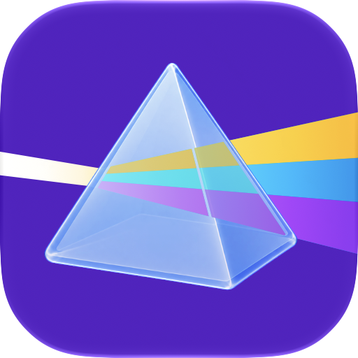
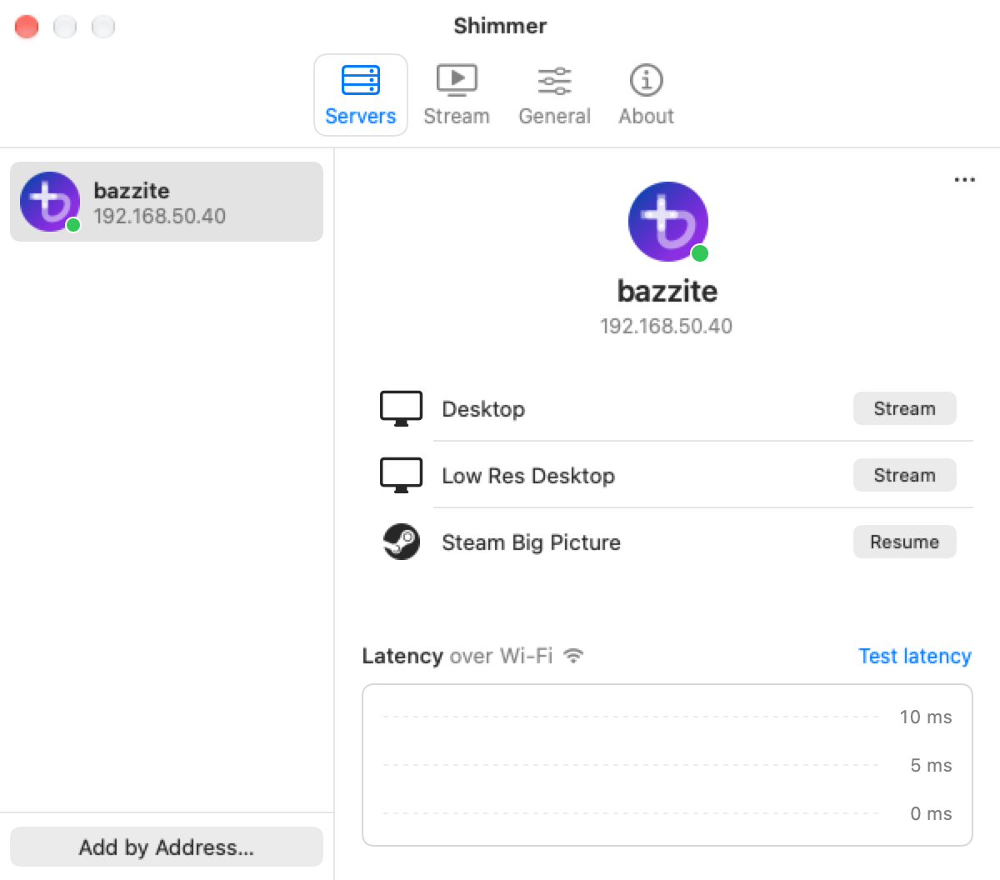
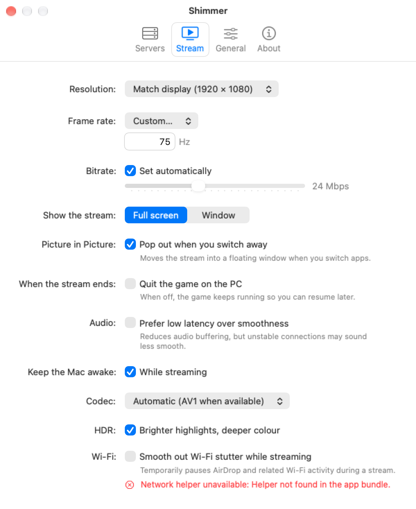

<p align="center">
  
</p>

# shimmer

A Mac-native client for [Sunshine](https://github.com/LizardByte/Sunshine) that
can pop the game out into macOS's floating **Picture in Picture** window - so it
stays in a corner while you use other apps, and your controller keeps playing.

shimmer is a fork of [glimmer](https://github.com/Se7enbrc/glimmer) by
[Se7enbrc](https://github.com/Se7enbrc): pure Swift, Apple Silicon only, the
whole pipeline - socket, decoder, display, audio, input - in one process with no
external player and no C engine. Everything glimmer does, shimmer does. The name
is a nod to the moonlight → sunshine → glimmer lineage it sits in.

<p align="center">
  
</p>

## What shimmer adds

- **Picture in Picture.** Press **⌃⌥P** during a stream, or choose Picture in
  Picture from the menu bar, and the game moves into the same floating,
  corner-snapping window macOS uses for movies - on top of your other apps,
  Spaces and full-screen windows. It's fed by the very layer the full-screen
  window paints into, so there is no second decode path and no extra latency.
  Controllers keep driving the game from the corner; keyboard and mouse stay
  with whatever app is frontmost, the way any PiP video behaves.
- **Pop out automatically** when you switch away from the stream (Stream ›
  Picture in Picture, on by default). Close the PiP window and the stream waits
  in the background; the Dock icon or the menu bar brings it back.
- **The mouse over the PiP window drives the host pointer** 1:1 (a click on the
  picture clicks there; dragging the window never reaches the host).
- **Works around two macOS AVKit bugs** in sample-buffer PiP that would
  otherwise show only the bottom-left corner of the picture (Apple
  FB22411168). Design notes and the manual test plan are in
  [`docs/design/`](docs/design/).
- **One window, laid out like a native Mac utility.** Servers, Stream, General
  and About tabs replace the separate launcher and Settings windows. Servers
  lists your paired PCs and the ones nearby, pairs them in place, shows each
  PC's apps with Stream and Resume buttons, and can measure latency over the
  link you're on - Wi-Fi, Ethernet or Tailscale.
- **A menu bar item that shows what's playing.** While you stream, the icon is
  the app you're streaming, with your DualSense's battery level; the menu has
  End Stream and Picture in Picture. It can hide itself when you're not
  streaming.
- **Home and away.** Give a PC a second address (its Tailscale address, say)
  and Shimmer falls back to it when the home address isn't reachable. A stream
  that drops because the Mac slept or changed networks doesn't leave a stale
  error behind.
- **`shimmerctl`**, a command-line tool that checks why a PC isn't reachable,
  reads the logs, and runs test streams - locally or on another Mac over SSH.
  See [docs/CLI.md](docs/CLI.md).
- Smaller things: a Linux / Windows / SteamOS logo per PC, a switch to stop
  sending the mouse, and keeping the Mac awake while you stream.

<p align="center">
  
</p>

### Relationship to glimmer

shimmer is based on glimmer 2026.9.0, plus fixes ported from later glimmer
releases (AV1 from AMD encoders, DualSense identity at stream start, packet
source checks, private logs, stream reliability). glimmer has kept moving
since - it now has its own floating Mini Player, iOS apps, and a separate
streaming engine framework. Merging those back in is planned; until then, if
you don't need macOS's system Picture in Picture, glimmer itself is the more
actively maintained choice.

## What you get

- **Video.** Hardware-decoded H.264, HEVC, and AV1, 8- and 10-bit, with a real
  PQ/HLG HDR pipeline. Up to 4K 240 Hz.
- **Pacing.** Locks the display to the stream cadence, runs passthrough on a
  clean link, buffers only for measured jitter. Tuned against per-frame
  telemetry.
- **Audio.** Opus through AVAudioEngine with a small adaptive cushion, so device
  switches and rough Wi-Fi don't crackle.
- **Controllers.** Xbox and DualSense: rumble, trigger rumble, gyro, touchpad,
  battery, light bar - whatever the pad has. Hold-to-quit chord. An optional
  raw-input mode (off by default, needs Input Monitoring) adds the DualSense
  buttons macOS hides and the host's adaptive-trigger effects.
- **Mouse and keyboard.** Raw 1:1 aim with the Mac's pointer acceleration
  removed, a velocity-gated boost on fast flicks, optional ⌘-shortcut
  forwarding.
- **Hosts.** mDNS discovery, PIN pairing, hosts by IP or name (Tailscale works),
  one-time import of moonlight-qt pairings.
- **Mac things.** Menu bar item, display-matched quality presets, stats overlay,
  hotkeys.

Nothing leaves your Mac. Diagnostics are off by default and write local files
under `~/Library/Logs/Shimmer`.

## Install

macOS 26+, Apple Silicon. Build from source (below) - shimmer isn't in a
Homebrew tap yet, and it does not auto-update (the upstream update feed is
deliberately disconnected so a shimmer build never replaces itself with stock
glimmer).

Signed ad-hoc when built locally, not sandboxed, not on the App Store
([docs/SECURITY.md](docs/SECURITY.md)).

Your host needs Sunshine and a display that can present the exact mode you ask
for: a virtual display driver on Windows, a current Sunshine on Linux.
[docs/HOST_SETUP.md](docs/HOST_SETUP.md).

## Build

Xcode 26 (Swift 6) and Homebrew.

```bash
git clone https://github.com/slaughterhousesoftware/shimmer.git
cd shimmer
brew install openssl@3 opus
make
```

`make` builds and installs `/Applications/Shimmer.app` the same way a release
ships. `make app` compile-checks, `make test` runs the unit tests,
`make uninstall` removes it. Without an Apple Developer ID, run
`make local-signing-setup` once first: builds are then signed with a stable
self-signed identity instead of ad hoc, so macOS keeps Input Monitoring
across rebuilds. The engine is under `Glimmer/Stream/` (the source
tree and Swift module keep glimmer's name; the app, bundle id
`com.kevinbpatel.shimmer`, and data folders are Shimmer's). Upgrading from a
glimmer install is automatic: on first launch Shimmer copies your pairings,
preferences, and client identity forward, and leaves glimmer's untouched.
[docs/ARCHITECTURE.md](docs/ARCHITECTURE.md),
[docs/CONTRIBUTING.md](docs/CONTRIBUTING.md).

## Why not Moonlight

Moonlight is excellent and glimmer would not exist without it. But moonlight-qt
is a Qt port of cross-platform C++, one layer from the hardware. glimmer - and so
shimmer - talks to VideoToolbox, AVAudioEngine, and GameController directly;
that is where the pacing, HDR, and controller work comes from, and it behaves
like a Mac app because it is one. It is also why Picture in Picture was
tractable here: the stream already renders through an
`AVSampleBufferDisplayLayer`, which is exactly what macOS PiP takes as a source.

## Support

glimmer is free software written in spare time.
[Sponsor its author on GitHub](https://github.com/sponsors/Se7enbrc) if it
makes your setup better.

## License

GPLv3. shimmer is a fork of glimmer, Copyright © 2026 ugfugl.io; shimmer's
additions are Copyright © 2026 Kevin Patel and are released under the same
license. See [LICENSE](LICENSE).

The transport is ported from
[moonlight-common-c](https://github.com/moonlight-stream/moonlight-common-c) and
[moonlight-qt](https://github.com/moonlight-stream/moonlight-qt), both GPLv3, so
glimmer is too, and so is shimmer. Full acknowledgment in
[CREDITS.md](CREDITS.md).
